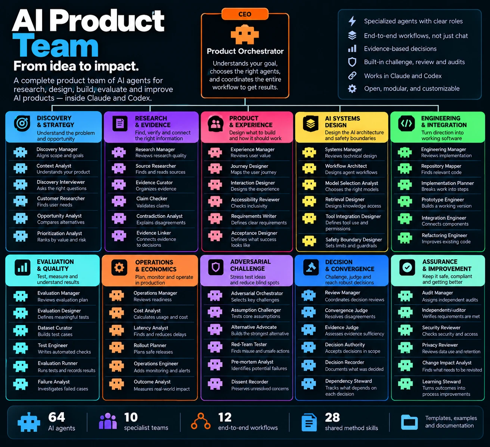

# AI Product Team

**64 specialist agents, 28 shared methods and 12 workflows for building AI features inside Claude Code and Codex.** Ask a product question in plain language. Your assistant runs only the specialists that question needs, and keeps a record of what every conclusion rests on.

[](https://github.com/3orionkings/ai-product-team/actions/workflows/ci.yml)
[](LICENSE)
[](https://3orionkings.github.io/ai-product-team/directory/)



<sub>The organization at a glance. The orchestrator at the top is the `aipt-workflow-orchestrator` role, and it runs in your own session. Three directors (Product, Engineering and Assurance) sit between it and the teams; they are not shown above. Browse every role in the [agent directory](https://3orionkings.github.io/ai-product-team/directory/).</sub>

---

## Why

When you pass a product problem between research, design and coding assistants, things go missing in the handoffs:

- the source of a requirement gets lost;
- an open question quietly becomes an accepted fact;
- "the tests pass" turns out to refer to yesterday's code;
- an agent's "done" is taken at its word.

This package gives a coding assistant a team that keeps those threads intact. Every role has one job, a method and a defined way it must not fail. Each workflow has review gates that can't be skipped, and every check, decision and piece of evidence is recorded in a ledger in your project.

The team is large because the jobs are different. Most requests use very little of it. "Summarize this design" runs two roles. "Should we ship this?" might run eight.

## Try it in five minutes

You need Python 3.12 or later, and Claude Code, Codex or both. There are no other dependencies.

```bash
git clone https://github.com/3orionkings/ai-product-team.git
cd ai-product-team

mkdir -p /tmp/aipt-demo && git -C /tmp/aipt-demo init
cp -r examples/support-copilot /tmp/aipt-demo/
python3 install.py --target /tmp/aipt-demo --host claude      # or --host codex, or --host both
```

Open `/tmp/aipt-demo` in Claude Code and type:

```
/aipt-shape-feature Turn the documents in support-copilot/corpus into a feature proposal.
```

The demo is a fictional help desk's reply-drafting feature with two built-in traps. An old slide says replies are sent automatically, while the current policy says drafts only. The material also contains a protected workspace-isolation requirement. A good run keeps the conflict visible, writes no requirement that authorizes sending, and leaves the sending decision open for you. `examples/support-copilot/scenario.md` describes what to look for.

In Codex, use `$aipt-shape-feature` instead. Both hosts can also start from plain language through the `aipt-start` skill. Remove everything with `python3 install.py --target /tmp/aipt-demo --uninstall`.

## Install into a real project

```bash
python3 install.py --target ~/code/my-app --host claude --dry-run   # shows what would change
python3 install.py --target ~/code/my-app --host claude
python3 install.py --target ~/code/my-app --status
python3 install.py --target ~/code/my-app --uninstall
```

The installer writes only under `.claude/`, `.codex/` and `.agents/` in that project, and records what it wrote in `.aipt/install-manifest.json`. It never edits your `CLAUDE.md`, `AGENTS.md`, settings or anything global. If a file it would write already exists and it didn't write it, or you have edited one it wrote, it stops and changes nothing. Uninstall removes only files that are still unchanged and keeps any you edited.

To check that Claude Code sees the team, type `/agents`. You should see 64 entries named `aipt-…`.

## The twelve workflows

| You want to… | Claude Code | Codex |
|---|---|---|
| decide whether AI belongs in a workflow at all | `/aipt-assess-opportunity` | `$aipt-assess-opportunity` |
| turn documents into a feature proposal with requirements and acceptance checks | `/aipt-shape-feature` | `$aipt-shape-feature` |
| design how an AI feature should work: components, tools, permissions, failure | `/aipt-design-system` | `$aipt-design-system` |
| build a bounded version that can be tested | `/aipt-build-prototype` | `$aipt-build-prototype` |
| evaluate a feature against its real task | `/aipt-evaluate-feature` | `$aipt-evaluate-feature` |
| find out why a feature is failing | `/aipt-investigate-failure` | `$aipt-investigate-failure` |
| know whether another model would do better | `/aipt-compare-models` | `$aipt-compare-models` |
| cut cost or waiting without losing required quality | `/aipt-optimize-cost-latency` | `$aipt-optimize-cost-latency` |
| know whether a feature is ready for a proposed release | `/aipt-review-release` | `$aipt-review-release` |
| know what to revisit after something changed | `/aipt-process-change` | `$aipt-process-change` |
| challenge a proposal and settle a disagreement | `/aipt-resolve-decision` | `$aipt-resolve-decision` |
| improve a method from verified outcomes | `/aipt-learn-from-outcomes` | `$aipt-learn-from-outcomes` |

Not sure which one? Use `/aipt-start` (or `$aipt-start`) with your request. The full procedure for each is in [`workflows/`](workflows/).

You can also call a single specialist for narrow work. In Claude Code, for example, ask for the `aipt-claim-checker` subagent to check whether a source supports a statement.

## How it works

**One dispatcher.** Your current session is the only one that starts roles. On Claude Code, no role is given the tool to start another; on Codex, each role is told not to. Directors and managers return plans and verdicts. They never start roles themselves.

**Selective routing.** Before doing any work, the session tells you:

- which roles it will run and which it will skip, and why;
- what it will write;
- what input is missing;
- what it will not do.

A stage is skipped when a current, accepted artifact already covers it. Review stages are never skipped. A budget mode caps role calls: focused 4, standard 12 (the default), deep 24.

**A case ledger.** Every source, claim, requirement, decision, review, check and approval becomes one line in `aipt-cases/<case>/ledger.jsonl` in your project, bound to a content hash. Lines are never edited; a change is a new version. A few rules follow from that:

- a test result stays true as history even after the code changes;
- a contradiction makes a claim *contested*, not false;
- a protected requirement survives a failed implementation;
- an approval covers exactly the version it was given for.

**Separated authority.**
- Specialists propose and managers review.
- Challengers attack a premise, and must name the test that would settle it.
- Judges rule on evidence, never on how many agents agree, and may answer "unresolved".
- The Decision Authority role accepts only what you have delegated.
- No role deploys, publishes, sends, pays or deletes. Those steps stop and ask you.

**Evidence over self-report.** A check counts only if the session actually ran the command and recorded its exit status. A role saying "tests pass" is recorded as a claim.

The rules are instructions the agents follow; in this release nothing enforces them in code. On Claude Code, each role's tool list is enforced by the host: read-only roles get no write or shell tools, and no role can start another. Codex does not support per-role permissions, so there every role runs with your session's permissions.

## The organization

| Team | Director | What it does | Examples |
|---|---|---|---|
| Discovery and strategy | Product | understand the problem and the opportunity | Context Analyst, Discovery Interviewer, Opportunity Analyst |
| Research and evidence | Product | find, check and connect the right information | Source Researcher, Claim Checker, Evidence Linker |
| Product and experience | Product | decide what to build and how it should work | Journey Designer, Requirements Writer, Acceptance Designer |
| AI systems design | Engineering | design the AI architecture and its boundaries | Workflow Architect, Retrieval Designer, Safety Boundary Designer |
| Engineering and integration | Engineering | turn direction into working software | Repository Mapper, Prototype Engineer, Refactoring Engineer |
| Evaluation and quality | Engineering | test, measure and understand results | Evaluation Designer, Test Engineer, Failure Analyst |
| Operations and economics | Engineering | cost, latency, rollout and real-world outcomes | Cost Analyst, Latency Analyst, Rollout Planner |
| Adversarial challenge | Assurance | stress-test ideas and expose blind spots | Assumption Challenger, Alternative Advocate, Red-Team Tester |
| Decision and convergence | Assurance | judge the evidence and reach sound decisions | Evidence Judge, Convergence Judge, Decision Authority |
| Assurance and improvement | Assurance | audit, secure and keep getting better | Independent Auditor, Security Reviewer, Learning Steward |

Every role's job, inputs, outputs, rule and failure case are in the [agent directory](https://3orionkings.github.io/ai-product-team/directory/), which is searchable and also works offline from [`docs/directory/`](docs/directory/). The full definitions are in [`agents/`](agents/), and the shared methods in [`skills/`](skills/).

## Status

**v0.1 (October 2026): every definition is written and checked. None has been evaluated on a live model yet.**

| Part | State |
|---|---|
| 64 roles, each with a positive and a negative scenario | written; pass the authoring checks |
| 28 shared methods | written; 11 adapted from the author's earlier drafts, 17 new |
| 12 workflows with entry skills, plus `aipt-start` | written |
| Claude Code files | generated; match the documented format (tested); live discovery not yet recorded |
| Codex files | generated from the documentation; never run (no working Codex CLI on the build machine) |
| Installer | tested: dry run, conflicts, symlinks, upgrade, uninstall |
| Experimental controller library (`src/`) | partly built; not connected to either host |
| Behavior evaluation of roles and workflows | not done |

What has not been shown yet:

- that the team does better than a single assistant;
- that both hosts load and run the files as intended;
- that any workflow completes end to end.

If you run one, a [run report](https://github.com/3orionkings/ai-product-team/issues/new?template=run_report.yml) is the most useful contribution you can make. The per-host records are in [`docs/compatibility/`](docs/compatibility/).

## Fork it, change it

Everything a host loads is generated from four source folders: `agents/`, `skills/`, `workflows/` and `entry/`, plus `registry/`. To make the team your own:

1. Edit a role or a method.
2. Rebuild with `python3 tools/build_adapters.py`.
3. Reinstall into your project.

[`docs/customizing.md`](docs/customizing.md) covers changing a role, adding a role, method or workflow, using only part of the team, renaming the `aipt-` prefix and keeping a fork current. The rules for writing roles and methods are in [`docs/architecture/authoring-contract.md`](docs/architecture/authoring-contract.md).

```bash
python3 tools/check_authoring.py agents && python3 tools/check_authoring.py skills
python3 tools/build_adapters.py && python3 tools/build_directory.py
PYTHONPATH=src python3 -m unittest discover -s tests -t .
```

Edit the sources, never `dist/`; CI fails when `dist/` is stale. See [CONTRIBUTING.md](CONTRIBUTING.md).

## Where the methods came from

Eleven of the 28 methods adapt the author's own unpublished drafts from early 2026: seven reasoning skills and four delivery runbooks (plan, implement, audit, status handoff). Each adapted method keeps its draft's procedure, conditions, output contract and guardrails. Its `references/adaptation-notes.md` lists what was kept, changed and dropped.

The other 17 methods and all 64 role definitions are new. Sources are listed by content hash in [`registry/sources.public.json`](registry/sources.public.json). No third-party skill text is included; see [THIRD_PARTY_NOTICES.md](THIRD_PARTY_NOTICES.md).

The design package the build followed is in [`docs/spec/`](docs/spec/): the product requirements, architecture, agent directory, workflows and implementation plan.

## The experimental controller

[`src/ai_product_team/`](src/ai_product_team/) is a standard-library Python library. It was meant to enforce the ledger rules in code:

- immutable versions in SQLite;
- impact tracing over declared dependencies;
- version-bound approvals;
- review-independence checks;
- budget admission;
- command receipts.

Eight modules are implemented and unit-tested. The run controller is incomplete, there is no command-line interface, and nothing connects the library to either host. The agents don't need it. [`docs/architecture/controller-contracts.md`](docs/architecture/controller-contracts.md) describes the design and marks what exists.

## Repository layout

```
agents/      64 role definitions                    entry/     the aipt-start entry skill
skills/      28 shared methods                      registry/  agents, methods, workflows, provenance
workflows/   12 workflow recipes                    dist/      generated Claude Code and Codex files
install.py   installer                              tools/     generators and authoring checks
examples/    synthetic support-copilot case         evals/     role and workflow scenarios (unrun)
docs/        directory, compatibility, design       src/ tests/  experimental library and test suite
```

## License

[MIT](LICENSE) © 2026 Emmanuel Benami. If you build on this, a link back is appreciated; [CITATION.cff](CITATION.cff) has the details.
